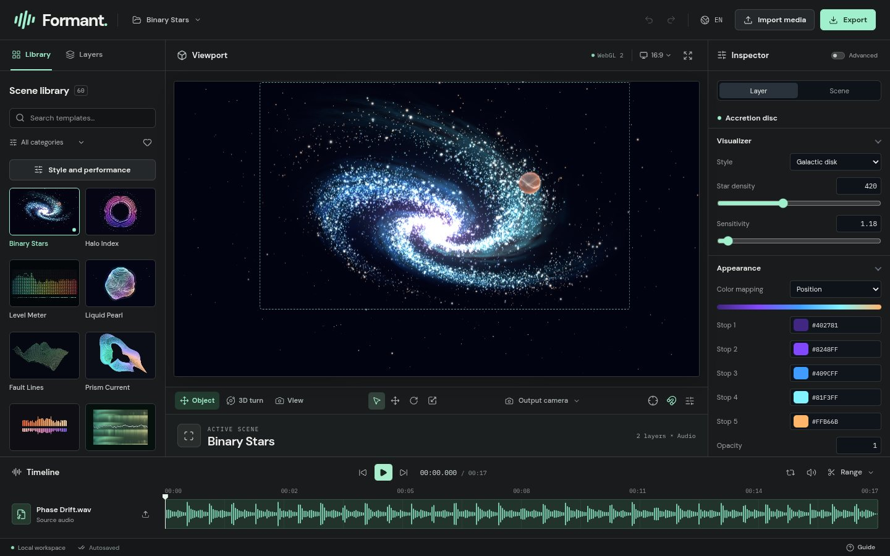

# Formant Studio

Formant Studio は、ローカルの楽曲や動画に立体的なオーディオビジュアライザーを合成し、MP4 または WebM を生成するブラウザ編集ツールです。Three.js と WebGL 2 で描く18ファミリー・60プリセットから始められます。音声解析、プロジェクト保存、動画エンコードは端末内で実行します。初回は同梱の楽曲「Phase Drift」とシーン「Binary Stars」が開きます。

[日本語ガイド](docs/GUIDE.ja.md) · [English guide](docs/GUIDE.en.md) · [テンプレート一覧](docs/TEMPLATES.md)



[改修前後の画面比較](docs/TOUCH-REVIEW.md) · [モバイル編集・ジェスチャー・スナップ](docs/TOUCH-EDITING.md) · [改修前調査](docs/REDESIGN-RESEARCH.md)

## 開発

Node.js 24 と npm を使用します。リポジトリ直下で実行してください。

```sh
npm ci
npm run dev
```

ブラウザで開き、**素材を読み込む**で楽曲または動画を選びます。ライブラリでシーンを選び、レイヤーとプロパティを調整し、タイムラインで出力範囲を指定します。**書き出し**は実際に試験エンコードが成功した組み合わせを表示します。オフライン利用には HTTPS または localhost で配信した本番ビルドの初回読み込みが必要です。

## Cloudflare Pages

既存の GitHub 連携で、このリポジトリのルートをプロジェクトルートに指定します。

| 設定 | 値 |
| --- | --- |
| Production branch | `main` |
| Build command | `npm run build` |
| Build output directory | `dist` |
| Node.js | `24`（.node-version） |

ビルドは型チェック、Vite の静的バンドル、ライセンス通知、SHA-256 付きオフラインキャッシュを生成します。ファイル単体 25 MiB と 20,000 ファイルの上限を超えると失敗します。配信時の CSP、COOP/COEP、キャッシュ制御は [public/_headers](public/_headers) にあります。Pages Functions、API キー、素材ストレージの構築は不要です。プレビュー配信の可否は既存の Pages ブランチ設定に従います。

```sh
npm run build
node scripts/serve-pages.mjs
```

`serve-pages` は Pages 用のヘッダーを適用して本番ビルドをローカルで検証します。資産の取り込み、オフライン更新、データ破損時の扱いは [プロジェクト形式と配信仕様](docs/PROJECT-FORMAT.md) に記載しています。

## 検証

```sh
npm run lint
npm test
npm run test:e2e
npm run test:stress
```

ブラウザ検査には Chromium、FFmpeg、ffprobe を使います。システムの Chromium を `CHROMIUM_PATH` で指定できます。長時間テストは短いテスト群とは個別に起動できます。計測条件、実機検証の範囲、再開手順は [PROGRESS.md](PROGRESS.md) を参照してください。

## 実装・仕様

| 項目 | 資料 |
| --- | --- |
| 全体構成・依存関係の選定 | [Architecture](docs/ARCHITECTURE.md) |
| シーン、変換、モジュレーション、バージョン移行 | [Scene model](docs/SCENE-MODEL.md) |
| 音声解析、PTS、入力形式 | [Audio analysis](docs/AUDIO-ANALYSIS.md) |
| ブラウザ・入出力形式 | [Compatibility](docs/COMPATIBILITY.md) |
| 形式・ビットレート・同期精度 | [Export and verification](docs/EXPORT.md) |
| 要件と検証範囲 | [Traceability](docs/REQUIREMENTS.md) |
