# Scene template catalog

All 60 scenes are generated from local geometry. Each thumbnail is a render of the corresponding scene using the same WebGL renderer as preview and export. The thumbnail test signal is synthetic and includes phase-separated stereo waves and a spectral history.

Run `node scripts/check-templates.mjs` to check all 60 presets in landscape, portrait and square frames. Use `--write` to regenerate the gallery after changing a scene. Chromium is required.

## Minimal · ミニマル

| Preview | English | 日本語 |
| --- | --- | --- |
| 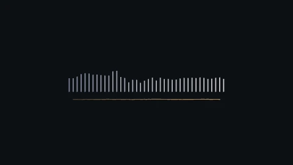 | Polar Needle | 極の針 |
|  | Quiet Interval | 静かな間隔 |
| 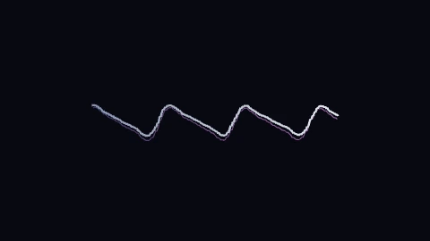 | Single Trace | 一本の軌跡 |
|  | Porcelain | 白磁 |
| 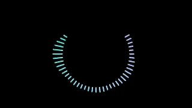 | Open Dial | 開いた文字盤 |

## Linear bars · 直線バー

| Preview | English | 日本語 |
| --- | --- | --- |
|  | Twin Rail | 双軌 |
|  | Stairwell | 階段室 |
| 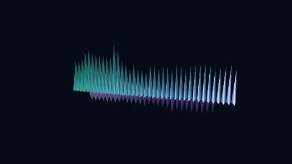 | Crystal Organ | 水晶のオルガン |
| 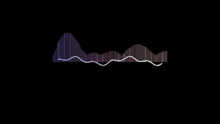 | Comb Filter | 櫛状フィルター |
|  | Offset Columns | 交差列 |

## Radial · 円形

| Preview | English | 日本語 |
| --- | --- | --- |
|  | Halo Index | 光輪の目盛 |
| 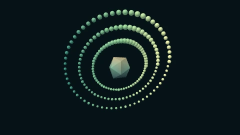 | Nested Orbit | 入れ子軌道 |
| 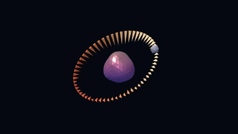 | Eclipse Gate | 日食の門 |
|  | Coiled Signal | 螺旋信号 |
| 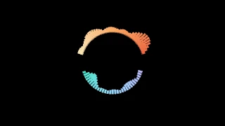 | East West | 東と西 |

## Waveforms · 波形

| Preview | English | 日本語 |
| --- | --- | --- |
|  | Oscillograph | オシログラフ |
|  | Phase Portrait | 位相の肖像 |
| 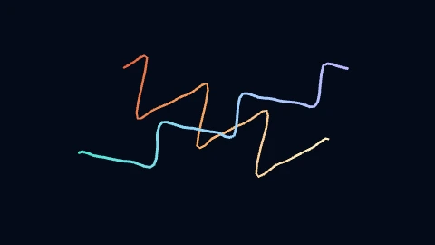 | Crossfeed | クロスフィード |
| 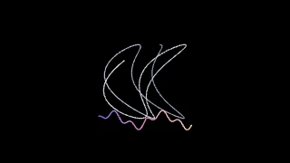 | Stereo Window | ステレオ窓 |
|  | Ribbon Stack | 重なるリボン |

## LED / Retro · LED・レトロ

| Preview | English | 日本語 |
| --- | --- | --- |
|  | Level Meter | レベルメーター |
| 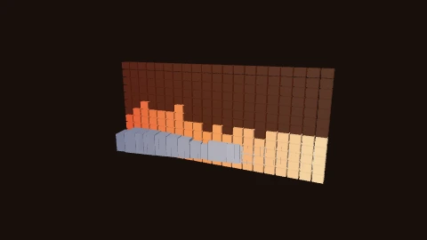 | Cartridge | カートリッジ |
| 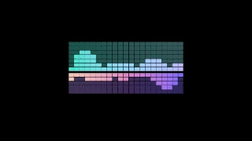 | Inverted Display | 反転表示 |
| 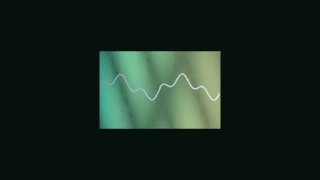 | Phosphor Scan | 蛍光走査 |
|  | Pocket Radio | ポケットラジオ |

## Neon · ネオン

| Preview | English | 日本語 |
| --- | --- | --- |
|  | Afterimage | 残光 |
|  | Electric Spine | 光る背骨 |
|  | Ion Mesh | イオン格子 |
|  | Signal Arch | 光のアーチ |
|  | Laser Harp | レーザーハープ |

## Cinematic · シネマティック

| Preview | English | 日本語 |
| --- | --- | --- |
| 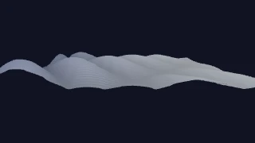 | Horizon Line | 地平線 |
| 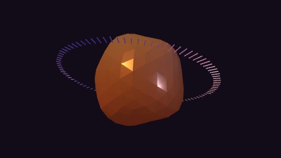 | Slow Eclipse | 静かな日食 |
| 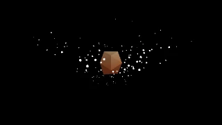 | Deep Focus | 深い焦点 |
|  | Dune Study | 砂丘習作 |
| 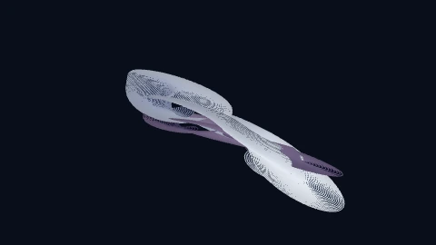 | Long Exposure | 長時間露光 |

## 3D grid · 3D格子

| Preview | English | 日本語 |
| --- | --- | --- |
|  | Block District | ブロック街区 |
| 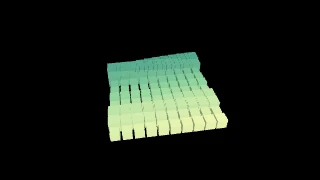 | Floating Tiles | 浮遊タイル |
| 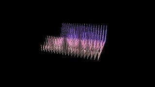 | Needle Field | 針の平原 |
| 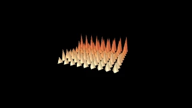 | Pyramid Array | ピラミッド群 |
| 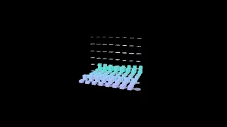 | Double Deck | 二重デッキ |

## Terrain / Waterfall · 地形・滝

| Preview | English | 日本語 |
| --- | --- | --- |
|  | Cascade | カスケード |
|  | Fault Lines | 断層線 |
| 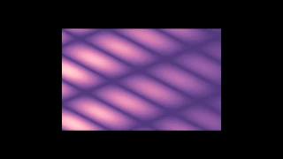 | Spectral Map | 周波数地図 |
| 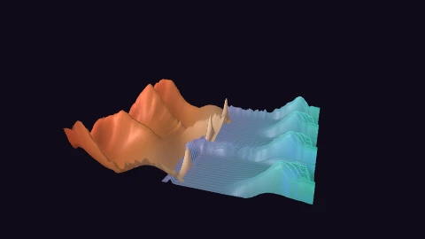 | Rift Valley | 裂谷 |
|  | Tidal Shelf | 潮の棚 |

## Spheres / Tunnels · 球体・トンネル

| Preview | English | 日本語 |
| --- | --- | --- |
| 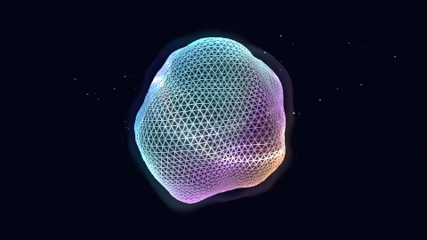 | Liquid Pearl | 液体の真珠 |
| 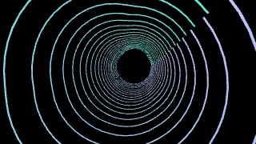 | Transit Tube | 通過管 |
|  | Orbital Pins | 球面ピン |
|  | Glass Satellite | ガラス衛星 |
| 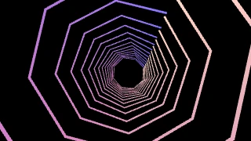 | Hex Passage | 六角回廊 |

## Particles · 粒子

| Preview | English | 日本語 |
| --- | --- | --- |
| 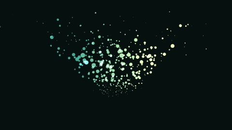 | Fireflies | 蛍 |
|  | Meteor Rain | 流星雨 |
| 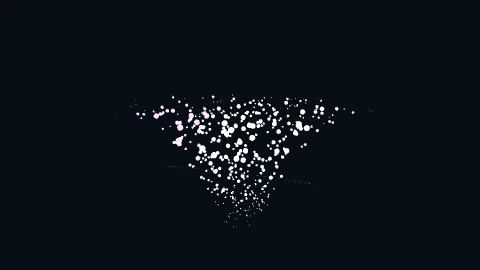 | Fountain | 噴水 |
| 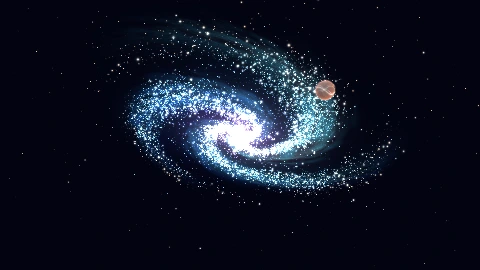 | Binary Stars | 連星 |
|  | Paper Drift | 紙片の漂い |

## Geometry · 抽象幾何学

| Preview | English | 日本語 |
| --- | --- | --- |
|  | Prism Current | プリズム・カレント |
|  | Facet Atlas | 面のアトラス |
| 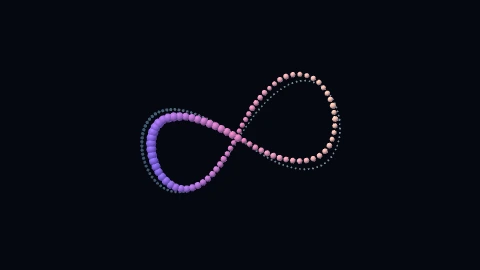 | Knot Script | 結び目の曲線 |
|  | Open Scaffold | 開放骨格 |
|  | Folded Paper | 折り紙 |
