# Scene template catalog / テンプレートの改修記録

60の既存IDを維持して全編を再調整した。下表は旧版の各シーンに対して選んだ改修と、その理由を示す。旧版の保存プロジェクトと書き出したプリセットはレイヤー・カメラ・設定を含んでおり、保存済みの構図を読み込める。お気に入りは従来のIDを使う。改修の内訳は再設計10件、複層化29件、既存構図・音応答の調整20件、主役の帯を継承した1件。

## カタログの数え方

60件は個別に編集できるプリセット数。主なシルエットと音で何が変わるかに従って数えると18系統になる。色、カメラ、密度、副レイヤーを変えた同系統の作品はこの内訳にまとめた。12件をおすすめとして掲載する。全プリセットの配色は原色・極光・残り火・氷晶から選べる。色替えは件数に含めない。描画負荷は層・粒子・効果の組み合わせを基にした目安で、端末のFPS保証は設けていない。

| 系統 | 編集可能なプリセット |
| --- | --- |
| 渦巻き銀河 | Binary Stars |
| 目盛・放射スペクトル | Halo Index, Open Dial, East West, Signal Arch |
| ダイオード計器 | Level Meter, Inverted Display, Cartridge, Pocket Radio |
| 発光線球 | Liquid Pearl, Ion Mesh |
| ひだ状の輪郭帯 | Prism Current, Long Exposure |
| 直線周波数列 | Polar Needle, Quiet Interval, Twin Rail, Comb Filter, Crystal Organ, Offset Columns, Laser Harp, Stairwell |
| 時間波形 | Single Trace, Oscillograph, Crossfeed, Ribbon Stack |
| ステレオ位相計 | Phase Portrait, Stereo Window |
| 立体と軌道の目盛 | Porcelain, Facet Atlas, Glass Satellite, Slow Eclipse, Eclipse Gate, Nested Orbit, Deep Focus |
| 分節らせん | Coiled Signal, Folded Paper |
| 曲線上の信号 | Electric Spine, Knot Script |
| 重なる回廊 | Afterimage, Transit Tube, Hex Passage |
| 立体直交格子 | Block District, Floating Tiles, Needle Field, Pyramid Array, Double Deck |
| 周波数履歴の地形 | Dune Study, Horizon Line, Cascade, Fault Lines, Rift Valley, Tidal Shelf |
| 平面周波数履歴 | Spectral Map, Phosphor Scan |
| 開放球体構造 | Open Scaffold, Orbital Pins |
| 粒子の奥行き | Fireflies, Paper Drift, Meteor Rain |
| 重力噴水 | Fountain |

## 画像と音入力の検証

旧版と新版の全60件を、同じ音・時刻・大きさで各組の左右に並べた。旧版はコミット `7906b2b` の描画コードとレシピを使用した。画像はすべて実際の Three.js / WebGL 2 の描画を読み戻したもので、同じ名前でも追加された構成要素を左右に見比べられる。

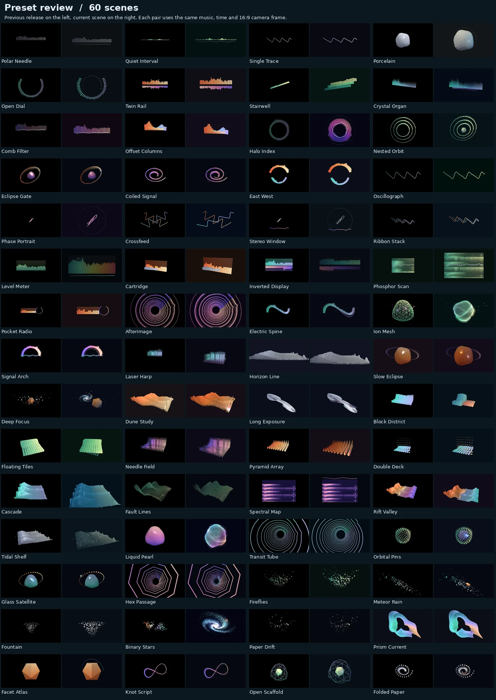

ギャラリーの表示サンプルはPCM音を実際の解析器に通し、計器に合う時刻を選んだ。XY位相計には左右に音差のある持続音を、LEDや放射状計器には多くの周波数帯に成分のあるブレイクビートを使用した。位相計に左右同じ信号を入れると点列は対角線に並び、無音では中心に集まる。

新版の60件それぞれに横480×270、正方形256×256、縦180×320、および共通の320×180で五つの条件を与えた。ダンス、アンビエント、ブレイクビート、アコースティックはリポジトリ内で生成した音源。下のシートは時刻つきの五つの観測画像を切り替える。連続再生の滑らかさは個別の動画プレビューと書き出しで確認できる。

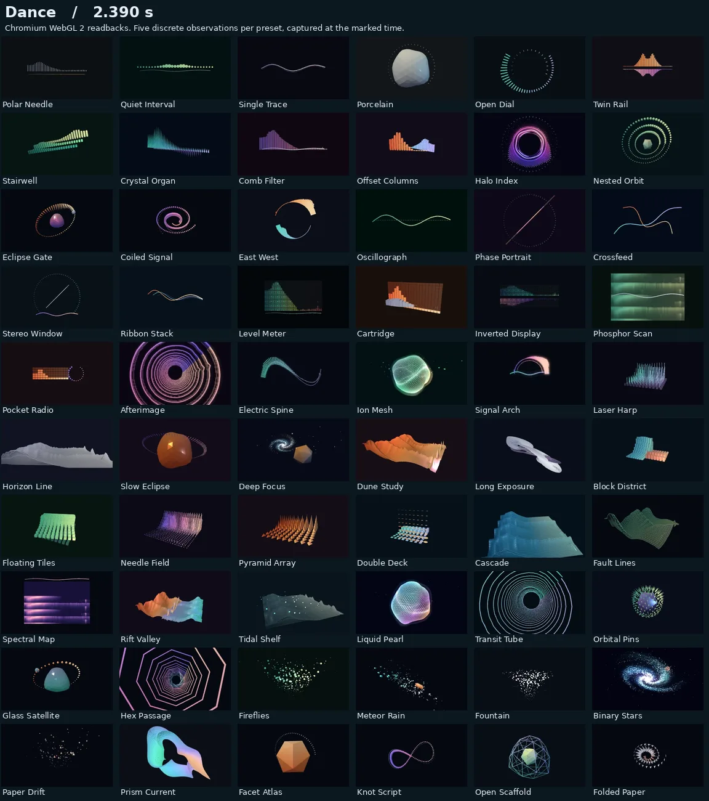

- 同じ2.390秒の打音・持続音・無音を比較すると、スペクトル列の立ち方、LEDが点灯する列、地形の尾根、位相図が変わる。帯・シェル・粒子は音が止まっても輪郭を保つ。
- 同じダンス音源の2.390秒と3.867秒で、短い打音から広帯域の打音への応答を比較した。波形・格子・スペクトル面の変化が特に読みやすい。星雲・多面体の音による局所変化は、一覧の縮小画像では細かい。
- すべてのプリセットで固定時刻の曲変更、同じ曲の時刻変更、打音から無音への変更に対するフレーム差分を検査する。数値上の差分だけで見栄えの判定を済ませず、上記の組画像と縦・正方形の一覧を目視した。

### 横・縦の構図

Level Meterは64列×31段のパネルと下段の波形を9:16でも読める寸法にした。Inverted Display、Pocket Radio、Polar Needle、Twin Railも横端の計器を収めるため、個別にカメラを調整した。Halo Index・Liquid Pearlは中央の主形に余白をとる。AfterimageとTransit Tubeは外周のゲートを画面外へ広げて奥行きをつくる。Horizon Lineや連続する横波形も、縦の出力では端を越えて画面が続く構図になる。

縦動画をつくる場合はプレビューの画面比率を9:16にし、カメラのズームと注視点を調整する。書き出し設定では1080×1920または希望のカスタム縦サイズを選ぶ。派生作品に字幕や画像を重ねる場合は、それらの位置も実際の出力比率で確認する。

### 再現方法

プロジェクトのルートで `node scripts/check-templates.mjs` を実行すると、縦・横・正方形の180フレームを描画する。`--write` はライブラリのWebPを更新する。`--audit /tmp/catalog-frames` は全480フレームおよび読戻し結果のJSONを保存し、共通時刻の入力差と同じ音源の時間差を検査する。`--source /path/to/previous-checkout` を指定すると、そのチェックアウトのシーンモデル・レシピ・レンダラーを同じ音入力で比較できる。旧チェックアウトからもThree.jsなどの依存を解決できるようにする。現行のカタログに `--palettes` を付けると同じ音・時刻で全60件の四配色（240フレーム）を実際に描画して比較する。ChromiumとWebGL 2が必要。

## Minimal · ミニマル

| Preview | Preset | 改修内容 |
| --- | --- | --- |
|  | Polar Needle 極の針 | **複層化**　細い周波数針の基準位置を、低い真鍮色の横線で読めるようにした。 |
| 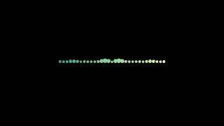 | Quiet Interval 静かな間隔 | **複層化**　等間隔の点列の下に小さな独立波形を通した。 |
|  | Single Trace 一本の軌跡 | **複層化**　主波形の下に薄い別の線を重ねた。小さな振幅の楽器音を表示サンプルに採用した。 |
| 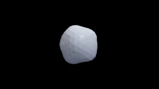 | Porcelain 白磁 | **複層化**　石に近寄り、途切れた輪郭と横からの反射を加えた。軌道のある立体群にまとめた。 |
|  | Open Dial 開いた文字盤 | **複層化**　太い丸目盛と短く粗い内周を分離した。 |

## Linear bars · 直線バー

| Preview | Preset | 改修内容 |
| --- | --- | --- |
|  | Twin Rail 双軌 | **構図・音応答調整**　左の低域と右の中域に異なる感度・リリースを与えて二列の音応答を分けた。 |
| 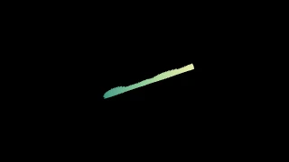 | Stairwell 階段室 | **再設計**　一列の立方体を、段差・奥行き・高さを変えた三段のテラスに組み直した。 |
|  | Crystal Organ 水晶のオルガン | **複層化**　高いフィンの下に短い逆向きのパイプ列を設置し、低い位置から照明を当てた。 |
|  | Comb Filter 櫛状フィルター | **構図・音応答調整**　連続波形と櫛を残し、直交カメラの注視点と歯の線幅を調整した。 |
| 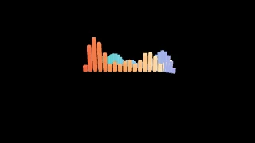 | Offset Columns 交差列 | **構図・音応答調整**　奥の逆向き周波数列を手前の銅色の列から分離する斜めの視点を選んだ。 |

## Radial · 円形

| Preview | Preset | 改修内容 |
| --- | --- | --- |
| 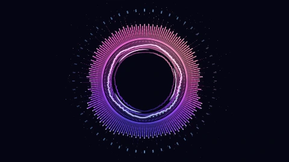 | Halo Index 光輪の目盛 | **再設計**　単一の円形バーを、波形・放射スペクトル・飛沫を描くGPU計器と外周の目盛に置き換えた。 |
|  | Nested Orbit 入れ子軌道 | **複層化**　複数の球列を傾け、中央に小さな結晶を置いて奥行きを読ませた。 |
|  | Eclipse Gate 日食の門 | **複層化**　光冠と本体に離れた小衛星を加えて対角線をつくった。 |
| 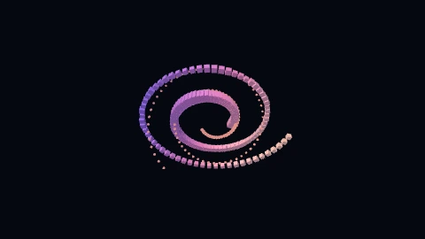 | Coiled Signal 螺旋信号 | **複層化**　太いブロックと逆方向に回る細いフィラメントを違う面に載せた。 |
|  | East West 東と西 | **構図・音応答調整**　周波数の内向き・外向きの関係を保ち、二つの弧の分割数に差をつけた。 |

## Waveforms · 波形

| Preview | Preset | 改修内容 |
| --- | --- | --- |
| 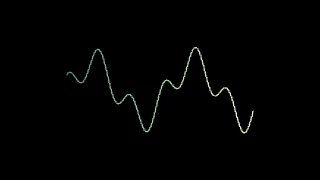 | Oscillograph オシログラフ | **複層化**　一筆の波形に静止した基準目盛を添えた。小音量でも計器の位置が分かる。 |
| 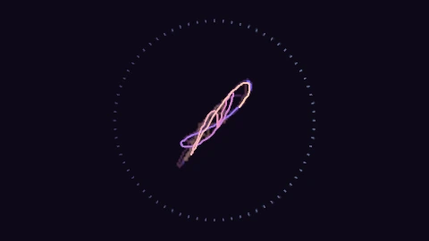 | Phase Portrait 位相の肖像 | **複層化**　位相線を境界目盛の内側へ置き、利得と線幅を調整して小さなループを見せた。 |
|  | Crossfeed クロスフィード | **構図・音応答調整**　交差する長い二本線を保ち、角度と長さを変えて見分けやすくした。 |
|  | Stereo Window ステレオ窓 | **複層化**　XY位相図の下の波形を残し、開いたベゼルを追加。位相図を拡大した。 |
| 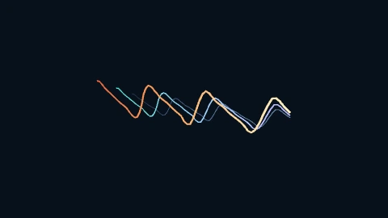 | Ribbon Stack 重なるリボン | **構図・音応答調整**　奥行きを分けた三本の波形を維持し、手前から奥の色温度と視点を調整した。 |

## LED / Retro · LED・レトロ

| Preview | Preset | 改修内容 |
| --- | --- | --- |
| 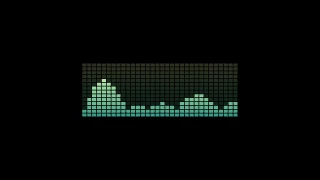 | Level Meter レベルメーター | **再設計**　平らな旧LEDを、立体レンズ・基板・ピーク表示・下段波形の計器に作り直した。 |
|  | Cartridge カートリッジ | **構図・音応答調整**　低密度の旧式表示と固定インジケーターを残し、基板の段差を斜めの視点から見せる。 |
|  | Inverted Display 反転表示 | **再設計**　二段の旧LEDを独立した実体レンズのバンクに入れ替え、下段を逆回転・逆周波数順とした。 |
|  | Phosphor Scan 蛍光走査 | **構図・音応答調整**　履歴面と現在波形の両方を広げ、平面の上で時間と周波数を読みやすくした。 |
| 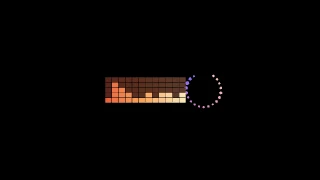 | Pocket Radio ポケットラジオ | **構図・音応答調整**　低解像度の小型表示と横の同調ダイヤルの組を残し、暖色の低い筐体として整えた。 |

## Neon · ネオン

| Preview | Preset | 改修内容 |
| --- | --- | --- |
| 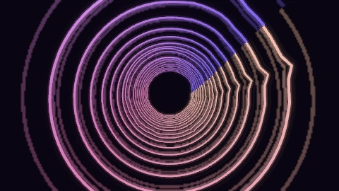 | Afterimage 残光 | **構図・音応答調整**　トンネルを維持して輪間隔・残光・ブルームを調整。Transit Tubeと同系統にまとめた。 |
| 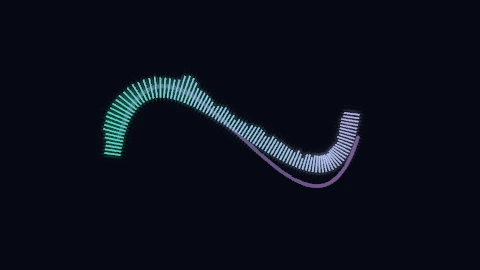 | Electric Spine 光る背骨 | **複層化**　ベジェ曲線の針の下に別の点列を通し、無音時にも経路が分かるようにした。 |
| 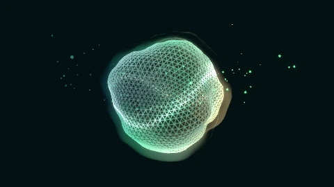 | Ion Mesh イオン格子 | **再設計**　塗りつぶした球を発光フィラメントに置き換え、中空の芯と周辺粒子を分離した。 |
| 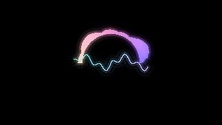 | Signal Arch 光のアーチ | **複層化**　大きな弧と下端の波形に短い内周を追加し、音が弱い部分にも高さの基準を置いた。 |
| 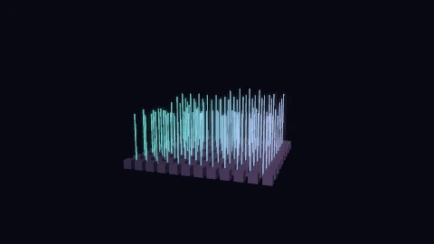 | Laser Harp レーザーハープ | **複層化**　格子の光線の下に独立した響板を設け、視点・弦数・ブルームを調整した。 |

## Cinematic · シネマティック

| Preview | Preset | 改修内容 |
| --- | --- | --- |
|  | Horizon Line 地平線 | **構図・音応答調整**　広い履歴の稜線を継承し、手前の面から遠景を見渡す浅い視点にした。 |
|  | Slow Eclipse 静かな日食 | **構図・音応答調整**　二層の環と天体を維持し、主天体の大きさと半球に当たる光を見直した。 |
|  | Deep Focus 深い焦点 | **再設計**　粒子と多面体を、遠い小銀河・手前の結晶レンズ・粗い塵の三層に再構成した。 |
| 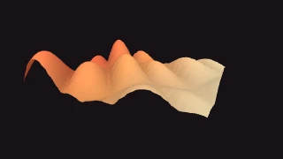 | Dune Study 砂丘習作 | **構図・音応答調整**　砂丘の履歴地形とカメラ旋回を継承し、斜光と陰影を整えた。 |
|  | Long Exposure 長時間露光 | **複層化**　平たい主帯の背後に、傾きと厚さの違う紫の細い帯を重ねた。 |

## 3D grid · 3D格子

| Preview | Preset | 改修内容 |
| --- | --- | --- |
| 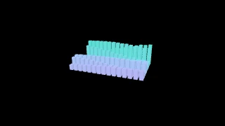 | Block District ブロック街区 | **再設計**　一枚の格子を高さと密度の違う街区と路面標示に分けた。 |
|  | Floating Tiles 浮遊タイル | **複層化**　タイルの下にずれた低い基壇を追加し、浮き上がる距離を見せた。 |
|  | Needle Field 針の平原 | **複層化**　細い針の床に低い点の層を置き、無音と強い音の高さの差を示した。 |
|  | Pyramid Array ピラミッド群 | **構図・音応答調整**　角錐格子の構成を残し、低いカメラと真鍮色の反射で各面を分けた。 |
|  | Double Deck 二重デッキ | **構図・音応答調整**　二段格子を保ち、カメラを近づけ上段と下段の配色を分けた。 |

## Terrain / Waterfall · 地形・滝

| Preview | Preset | 改修内容 |
| --- | --- | --- |
| 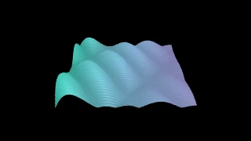 | Cascade カスケード | **構図・音応答調整**　格子の解像度と斜めからの視点を見直し、周波数履歴の尾根の間隔を出した。 |
| 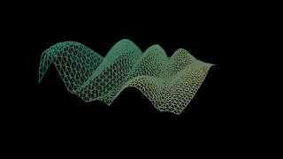 | Fault Lines 断層線 | **複層化**　一枚のワイヤー地形の下に連続した暗い面を加え、線と地表を重ねた。 |
|  | Spectral Map 周波数地図 | **複層化**　履歴面の上端に独立した現在波形を増設した。 |
|  | Rift Valley 裂谷 | **構図・音応答調整**　二つの履歴面の割れ目を維持し、視点と寒暖の照明で中央の谷を見せた。 |
| 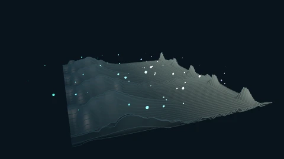 | Tidal Shelf 潮の棚 | **構図・音応答調整**　粒子と低い棚を保ち、光と低いカメラで粒子の高さを分離した。 |

## Spheres / Tunnels · 球体・トンネル

| Preview | Preset | 改修内容 |
| --- | --- | --- |
|  | Liquid Pearl 液体の真珠 | **再設計**　塗りつぶした球を、表層・背面・光の筋を持つ発光球と外側の微粒子に作り直した。 |
|  | Transit Tube 通過管 | **構図・音応答調整**　単一の円形回廊を生かし、輪の数・奥行き・線幅を調整した。 |
| 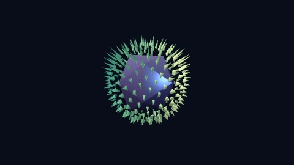 | Orbital Pins 球面ピン | **複層化**　トゲ状の球面格子が囲む藍色の芯を追加し、外側への長さを見せた。 |
| 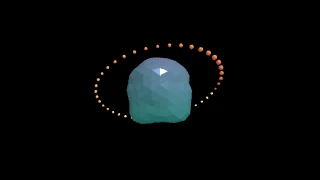 | Glass Satellite ガラス衛星 | **複層化**　金の点列の外側に小さな別の衛星を配置した。Facet Atlasなどと同系統に整理した。 |
|  | Hex Passage 六角回廊 | **複層化**　外周の多角形回廊に別の傾き・速度の小さな内門を加えた。 |

## Particles · 粒子

| Preview | Preset | 改修内容 |
| --- | --- | --- |
|  | Fireflies 蛍 | **複層化**　粒径・距離・寿命・速度の異なる奥の粒子群を追加した。 |
| 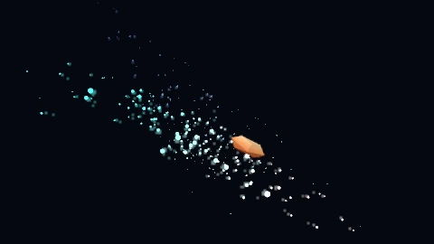 | Meteor Rain 流星雨 | **再設計**　単層の粒子群を二筋の流星雨と大きな先頭の流星に組み直した。 |
|  | Fountain 噴水 | **複層化**　落下する粒の下に横倒しの円形水盤を設け、上下方向の噴流を読ませた。 |
|  | Binary Stars 連星 | **再設計**　二つの粒子群を、腕・核・塵・周辺星からなる渦巻き銀河と小さい伴星に作り直した。 |
| 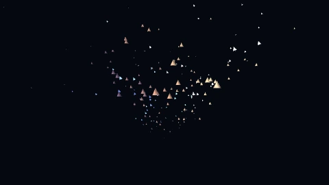 | Paper Drift 紙片の漂い | **複層化**　遠い小片に違う角度と滞空時間を与えて二層にした。 |

## Geometry · 抽象幾何学

| Preview | Preset | 改修内容 |
| --- | --- | --- |
| 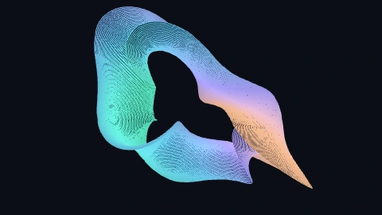 | Prism Current プリズム・カレント | **継承**　従来の主役の帯と色を継承。色替えとカタログの説明、照明・全体の構図を更新した。 |
| 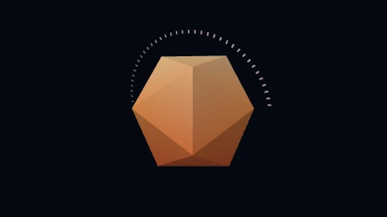 | Facet Atlas 面のアトラス | **複層化**　回る多面体に粗い測量弧を加えた。稜の明暗と円弧に余白を残した。 |
|  | Knot Script 結び目の曲線 | **複層化**　太い二重ループの軌道に、異なる角度で揺れる細かな点列を重ねた。 |
| 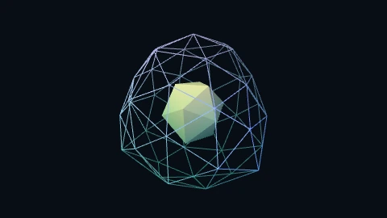 | Open Scaffold 開放骨格 | **構図・音応答調整**　開放した骨組みと独立して回る内側の立体を保ち、光と視点を近づけた。 |
| 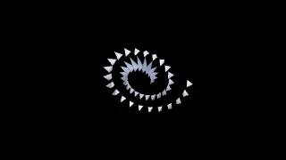 | Folded Paper 折り紙 | **複層化**　傾いた三角翼に、傾斜・半径・周期の違う短い逆巻きを加えた。 |
